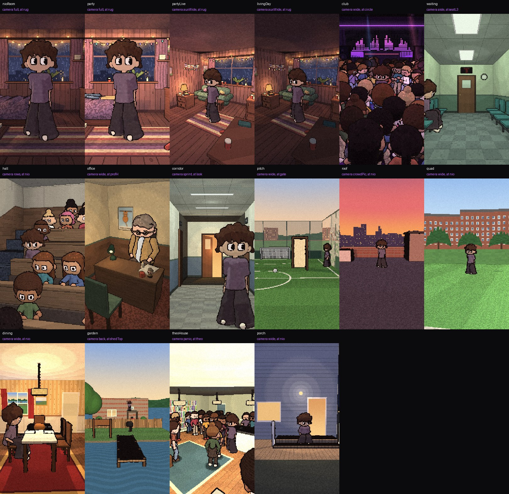

# The rig: sets, cameras, cast

The 3D rig (`studio/world3d`) draws Nio World. `rig/sets.jpg` is one picture of every set. `rig/<set>.jpg` is every
camera of the sets used most (nioRoom, club, roof, quad). For any other set, `python3 studio/rig.py list <set>` says
which camera sees which place, and a still takes twenty seconds.

## The sets

| Set | What it is | Good for |
|---|---|---|
| `nioRoom` | Nio's bedroom at night, rain on the window, fairy lights | Alone with the phone: the group chat, the couch decision |
| `party`, `partyLive` | The same flat dressed for a party; `partyLive` is the living room full of people | Hosting at home, a night that goes wrong |
| `livingDay` | The living room, tidy, lamps on. The window still shows a dark, wet evening, so it is never "1 PM" | The sofa, the day after |
| `club` | A packed floor around a cleared circle, the DJ booth, the bar | Any night out: dancing, karaoke (hold `mic`), a show |
| `roof` | A flat roof at sunset, the skyline | A hook, golden hour, a rooftop party |
| `quad` | Campus lawn in daylight, brick halls | Daytime, a run club, meeting someone |
| `pitch` | A five-a-side cage at dusk, floodlights | Sport, a pickup game |
| `porch` | A house front at night, the door lit | Arriving, leaving, waiting for a ride |
| `dining` | A family dining room in daylight | Home, a birthday, a dinner |
| `theoHouse` | A house party seen from inside, a crowd | Hosting at home |
| `garden` | A back garden down to a lake, a shed | A day party, a barbecue |
| `waiting`, `hall`, `office`, `corridor`, `bath` | Campus rooms | Skits |

There is no street, no bar interior, no rink, no restaurant. A night the rig cannot show is shown another way (the
map, the chat, the real card) or gets a few lines of new set in `studio/world3d/src/nw3d/`.

## Choosing the camera

- `python3 studio/rig.py list <set>`: "sees" means that person's head is whole in the picture; "cuts" means the
  frame edge slices it. A hold that raises the arms (`arms-up`, `arm-up`, `mic`) needs room above the head: in the
  club, `low` and `wide` have it, `mid` does not.
- The world refuses a shot it cannot show well (a back nobody asked for, someone out of frame, a seat with a
  standing action). `rig.py check` prints every reason.
- One or two people a shot. Eyes go to the phone, the person or the thing: `gaze: [0, -0.9]` looks down at a held
  phone, and `glow` lights the face from the screen. `look: 'camera'` only when the script asks for it.
- A face changes on the word that causes it: `"face": [[0, "deadpan"], [49, "suspicious"]]`, frames at 24 a second.

## What a person can do

Cast: nio, maya, sami, theo, imane, and the strangers (`rig.py list` prints all of them). Viewers do not know
their names, so a video says "you" and "your friend".

Actions: stand, talk, walk, jog, sprint, stepBack, sit, sitTalk, dance, crouch, pickUp, touch, faint, lie.
Holds: phone, selfie, show-phone, photo, arms-crossed, point, arm-up, arms-up, cup, wave, mic, pizza, and more.
Faces: neutral, deadpan, hyped, laughing, shock, uneasy, suspicious, sheepish, smug, charm, crushed, real, asleep.

**Talking.** The rig moves a mouth from a voice line: an actor's `speak` takes mouth cues by frame, and `acc` the
stressed beats. The tools that turn a voice file into those cues are in the old engine
(`archive/2026-11-old-engine/engine/tools/lipsync.py`, `accents.py`) and are not yet wired into `studio/`. That is
the one step between today and Nio talking to camera in his own voice (`studio/cast_voice.py`).

A new prop is a few lines in `studio/world3d/src/nw3d/room.ts` (the microphone was added this way).
